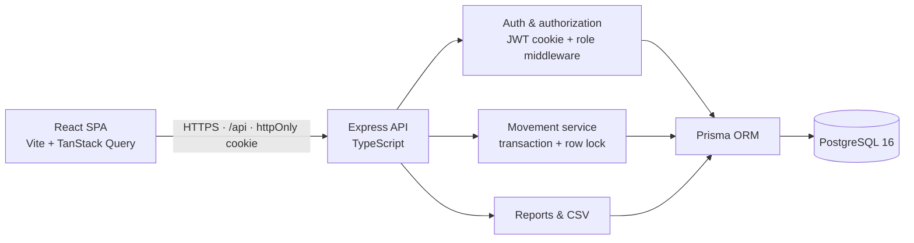
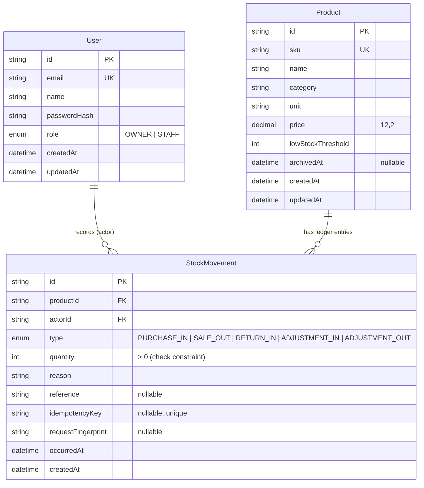

# 📦 StockLedger

<p align="center">
  <strong>A ledger-first inventory management system built for accuracy, auditability, and concurrency safety.</strong>
  <br />
  Track inventory through purchases, sales, customer returns, and adjustments — stock is derived from the movement ledger, never edited directly.
</p>

<p align="center">
  <a href="https://github.com/shubh-a11y/StockLedger"></a>
  <a href="#screenshots"></a>
  
  
  
  
</p>

<p align="center">
  <a href="YOUR_DEMO_VIDEO_URL">▶️ Watch Demo Video</a>
  &nbsp; • &nbsp;
  <a href="https://github.com/shubh-a11y/StockLedger">📂 View Source Code</a>
</p>

---

## 🖼️ Screenshots

<table>
  <tr>
    <td align="center" width="50%">
      <strong>Login</strong><br />
      
    </td>
    <td align="center" width="50%">
      <strong>Inventory Management</strong><br />
      
    </td>
  </tr>
  <tr>
    <td align="center" width="50%">
      <strong>Product and Stock Details</strong><br />
      
    </td>
    <td align="center" width="50%">
      <strong>Stock Movement Ledger</strong><br />
      
    </td>
  </tr>
</table>

---

## Contents

1. [Project overview](#project-overview)
2. [Feature list](#feature-list)
3. [Screenshots](#screenshots)
4. [Architecture](#architecture)
5. [Tech stack](#tech-stack)
6. [Prerequisites](#prerequisites)
7. [Environment setup](#environment-setup)
8. [Docker & PostgreSQL](#docker--postgresql)
9. [Installation](#installation)
10. [Prisma migrations](#prisma-migrations)
11. [Database seeding](#database-seeding)
12. [Running the apps](#running-the-apps)
13. [Demo accounts](#demo-accounts)
14. [API documentation](#api-documentation)
15. [Database schema](#database-schema)
16. [Stock calculation semantics](#stock-calculation-semantics)
17. [Concurrency-control strategy](#concurrency-control-strategy)
18. [Authentication & authorization](#authentication--authorization)
19. [Validation and error format](#validation-and-error-format)
20. [Automated tests](#automated-tests)
21. [Manual browser verification](#manual-browser-verification)
22. [Production build](#production-build)
23. [Deployment](#deployment)
24. [Environment variable reference](#environment-variable-reference)
25. [Security notes](#security-notes)
26. [Completed features](#completed-features)
27. [Known limitations](#known-limitations)
28. [Future improvements](#future-improvements)
29. [Submission checklist](#submission-checklist)
30. [AI tools used](#ai-tools-used)

---

## Project overview

StockLedger is a modular monolith:

- `apps/api` — Express + TypeScript REST API, Prisma/PostgreSQL data layer, authentication,
  role-based authorization, transaction-safe movement service, reports and CSV export.
- `apps/web` — React + TypeScript single-page application built with Vite, Tailwind CSS v4,
  TanStack Query, React Hook Form + Zod, Radix UI primitives, Framer Motion and Recharts.
- `docker-compose.yml` — local PostgreSQL 16 with a dedicated `stockledger_test` database created
  by `docker/init/01-create-test-db.sql` on first startup.

The product name is **StockLedger**. The visual direction is premium retail operations software:
vibrant orange (`#F26722` / accessible `#C2410C`) with warm off-white canvas (`#FAF7F2`), charcoal
ink (`#1B1613`), emerald success states and restrained motion.

---

## Feature list

**Authentication & roles**

- Email/password login with Argon2id hashing and HTTP-only, SameSite session cookies.
- Two roles only: `OWNER` and `STAFF`.
- Role is re-read from PostgreSQL on every authenticated request, so a changed role cannot be
  carried by an old token.
- Server-side enforcement on every route; UI hiding is cosmetic only.
- Login rate limiting, generic credential errors and no account-enumeration messages.

**Products**

- Unique SKU, name, category, unit, decimal price, low-stock threshold, timestamps.
- Calculated current stock from the movement ledger (never stored/editable on the product).
- Search by name/SKU, category filter, stock-status filter (`healthy`, `low`, `out`), allowlisted
  sorting, pagination and archived visibility for owners.
- Owner-only create, update and archive. Archive preserves movement history; no hard delete.

**Stock movements**

- `PURCHASE_IN`, `SALE_OUT`, `RETURN_IN`, `ADJUSTMENT_IN`, `ADJUSTMENT_OUT`.
- Positive integer quantity only; the server derives direction from the type.
- Actor, reason, optional reference, occurrence timestamp, unique ID and optional idempotency key.
- Append-only: no update/delete endpoints. Corrections are compensating adjustments.
- Actor-scoped idempotency: safe retries return the original movement; key reuse with a different
  payload returns `409 IDEMPOTENCY_KEY_REUSED`.

**Dashboard & reports**

- Live totals: active products, units on hand, low stock, out of stock.
- Low-stock warning list and 14-day incoming/outgoing activity chart from real API data.
- Recent movement feed.
- Owner-only low-stock report and formula-safe, streamed CSV export.

**Interface**

- Desktop sidebar, mobile navigation drawer, top bar breadcrumbs, account menu.
- Loading skeletons, empty states, error/retry states, toasts, accessible dialogs.
- Responsive tables on desktop and card lists on mobile; no horizontal page overflow at
  360/390/768/1024/1440 px.
- Reduced-motion support, keyboard navigation, labelled inputs, associated inline errors and
  text + icon status badges (not colour alone).

---

## Architecture



Backend structure:

```text
apps/api/src/
  app.ts                  Express composition (helmet, CORS, cookies, routers, errors)
  server.ts               boot + graceful shutdown
  config/env.ts           validated environment (fails fast)
  db/prisma.ts            Prisma client
  middleware/             authenticate, authorize, validate, origin-check, rate-limit, errors
  modules/
    auth/                 routes, controller, service, schemas, session helpers
    products/             routes, controller, service, repository, schemas
    movements/            routes, controller, service, repository, schemas
    reports/              routes, controller, service
  utils/                  ApiError, async handler, stock math, CSV, fingerprint
apps/api/tests/           unit + PostgreSQL-backed integration tests
```

Frontend structure:

```text
apps/web/src/
  App.tsx                 routes + guards
  components/             layout, products, movements, UI primitives
  hooks/use-auth.tsx      session state via TanStack Query
  lib/api.ts              typed fetch client + API error model
  pages/                  login, dashboard, products, product detail, ledger, low stock, reports
  styles.css              Tailwind v4 theme tokens and base styles
```

---

## 🧰 Tech stack

<p align="center">
  
  
  
  
  
  
  
  
  
</p>

| Layer | Technology |
| --- | --- |
| Frontend | React 18, TypeScript (strict), Vite 6, Tailwind CSS 4, Framer Motion 11, Lucide React |
| UI system | Radix UI primitives (Dialog, Select, Dropdown Menu) styled as app components |
| Data/forms | TanStack Query 5, React Hook Form 7, Zod 3, Recharts 2 |
| Backend | Node.js 22, Express 4, TypeScript, Zod, Prisma 6 |
| Database | PostgreSQL 16 |
| Auth | Argon2id (`argon2`), `jsonwebtoken` HS256, HTTP-only cookie, login rate limiting |
| Security | Helmet, explicit CORS allowlist, Origin-check CSRF defence, rate limits, DB check constraints |
| Tests | Vitest 2, Supertest 7, dedicated PostgreSQL test database |
| Tooling | Docker Compose, Prisma migrations, tsx, concurrently |

No microservices, Redis, Kubernetes or unnecessary infrastructure.

---

## Prerequisites

- Node.js **22+** and npm **10+** (verified with Node 22.14.0 / npm 10.9.2)
- Docker Desktop (verified with Docker 29.1.3) **or** a local PostgreSQL 16+ server
- Git
- Ports `4000` (API), `5173` (web dev), `5432` (PostgreSQL) free

---

## Environment setup

```bash
# Backend
cp apps/api/.env.example apps/api/.env

# Frontend
cp apps/web/.env.example apps/web/.env
```

Edit `apps/api/.env`:

- Replace `JWT_SECRET` with a long random value:
  `openssl rand -base64 48` (must be at least 32 characters; the API refuses to boot otherwise).
- Change the demo seed passwords if you want different local credentials.
- Leave `COOKIE_SAMESITE=lax` for the local same-site setup.

The root [`.env.example`](.env.example) is the complete reference for every variable.

`.env` files are git-ignored; only the examples are tracked.

---

## Docker & PostgreSQL

```bash
docker compose up -d db
docker compose ps
```

The container exposes PostgreSQL on `localhost:5432` and runs
`docker/init/01-create-test-db.sql` on first volume initialisation, creating both
`stockledger` and `stockledger_test`.

If your Docker volume already existed before this project added the init script, create the test
database once:

```bash
docker exec stockledger-db psql -U stockledger -d postgres -c "CREATE DATABASE stockledger_test;"
```

Check connectivity:

```bash
docker exec stockledger-db pg_isready -U stockledger -d stockledger
```

---

## Installation

```bash
npm install
npm run db:generate
```

`npm install` installs both workspaces (npm workspaces).

---

## Prisma migrations

Development (creates a migration when the schema changes):

```bash
npm run db:migrate
```

Apply existing migrations without prompting (CI/deployment):

```bash
npm run db:deploy
```

Initial migration includes the tables, indexes, foreign keys and database-level check constraints:

- `StockMovement.quantity > 0`
- `StockMovement.reason` not blank
- `Product.price >= 0`
- `Product.lowStockThreshold >= 0`
- `Product.sku` not blank
- unique `Product.sku`, unique nullable `StockMovement.idempotencyKey`

The integration suite applies migrations to `TEST_DATABASE_URL` automatically in
`apps/api/tests/global-setup.ts`, and refuses to run unless that database name ends in `_test`.

---

## Database seeding

```bash
npm run db:seed
```

The seed is idempotent: users and products are upserted, and movements use stable
`seed:<sku>:<type>:<index>` idempotency keys with `createMany({ skipDuplicates: true })`. Running it
again creates **0** duplicate movements (verified locally).

It seeds:

- 1 owner, 2 staff
- 12 products across Electronics, Groceries, Stationery, Apparel and Home
- 34 movements across the last 28 days, including purchases, sales, customer returns and
  adjustments
- healthy stock, low stock (at/below threshold), equal-to-threshold stock, and two zero-stock
  scenarios (one sold down to zero, one with no movements at all)

Credentials come from `SEED_*` environment variables in `apps/api/.env`.

---

## Running the apps

From the repository root:

```bash
npm run dev
```

- Web: <http://localhost:5173>
- API: <http://localhost:4000>
- Health: <http://localhost:4000/api/health>

Or run separately:

```bash
npm run dev -w @stockledger/api
npm run dev -w @stockledger/web
```

---

## Demo accounts

These are **development-only** credentials created by `npm run db:seed`, using the values in
`apps/api/.env`. They must be changed or removed before any real deployment.

| Role | Email | Password |
| --- | --- | --- |
| Owner | `owner@example.com` | `OwnerDemo123!` |
| Staff | `staff@example.com` | `StaffDemo123!` |
| Staff | `staff2@example.com` | `StaffDemo123!` |

On the login page in development, the demo account cards fill the form for you. Demo cards are
compiled out of production builds (`import.meta.env.DEV`).

---

## API documentation

Base URL: `/api`. All endpoints except `POST /api/auth/login`, `POST /api/auth/logout` and
`GET /api/health` require the session cookie.

### Authentication

| Method | Path | Access | Description |
| --- | --- | --- | --- |
| `POST` | `/auth/login` | public | Verify credentials, set HTTP-only cookie |
| `POST` | `/auth/logout` | public | Clear cookie |
| `GET` | `/auth/me` | authenticated | Current user + role from database |

### Products

| Method | Path | Access | Description |
| --- | --- | --- | --- |
| `GET` | `/products` | owner, staff | Paginated list with calculated stock and filters |
| `GET` | `/products/categories` | owner, staff | Distinct active categories |
| `POST` | `/products` | owner | Create product (stock starts at 0) |
| `GET` | `/products/:id` | owner, staff | Product metadata + calculated stock |
| `PATCH` | `/products/:id` | owner | Update metadata (no stock field exists) |
| `DELETE` | `/products/:id` | owner | Archive product (history preserved) |
| `GET` | `/products/:id/movements` | owner, staff | Paginated movement history |

Product list query parameters: `page`, `pageSize` (max 100), `search`, `category`,
`stockStatus` (`all|low|out|healthy`), `sort` (`name|sku|category|price|stock|threshold|createdAt|updatedAt`),
`order` (`asc|desc`), `includeArchived` (owner only, `true|false`).

### Movements

| Method | Path | Access | Description |
| --- | --- | --- | --- |
| `GET` | `/movements` | owner, staff | Searchable ledger (`page`, `pageSize`, `productId`, `type`, `search`, `from`, `to`, `sort`, `order`) |
| `POST` | `/movements/purchase` | owner | Purchase in |
| `POST` | `/movements/sale` | owner, staff | Sale out |
| `POST` | `/movements/return` | owner, staff | Customer return in |
| `POST` | `/movements/adjustment` | owner | Adjustment with explicit `direction: "IN" \| "OUT"` |

Movement body:

```json
{
  "productId": "cm...",
  "quantity": 3,
  "reason": "Weekly supplier delivery",
  "reference": "PO-1042",
  "idempotencyKey": "0f4c9a2e-..."
}
```

`quantity` must be a positive integer ≤ 1,000,000. The server chooses the sign. Sending a
`stock`/`balance` field is rejected by strict validation.

### Reports

| Method | Path | Access | Description |
| --- | --- | --- | --- |
| `GET` | `/reports/dashboard` | owner, staff | Totals, low-stock list, recent movements, 14-day activity |
| `GET` | `/reports/low-stock` | owner | Products with calculated stock ≤ threshold |
| `GET` | `/reports/stock.csv` | owner | Streamed CSV snapshot |

CSV columns: `SKU, Name, Category, Unit, Price, Current Stock, Low-Stock Threshold, Status`.
Archived products are excluded; zero-stock products are included. Filename pattern:
`stockledger-stock-YYYY-MM-DD.csv`.

### Status codes

| Code | Meaning |
| --- | --- |
| `200` | Successful read/update (or idempotent replay) |
| `201` | Movement or product created |
| `400` | Malformed input / validation failure |
| `401` | Not authenticated / invalid session |
| `403` | Authenticated but not allowed |
| `404` | Missing resource |
| `409` | Conflict: insufficient stock, duplicate SKU, archived product, idempotency key reuse |
| `429` | Login rate limit exceeded |
| `500` | Unexpected server error (safe message only) |
| `503` | Health check when the database is unreachable |

### cURL examples

```bash
# Login (cookie jar)
curl -c cookies.txt -H "Content-Type: application/json" \
  -d '{"email":"owner@example.com","password":"OwnerDemo123!"}' \
  http://localhost:4000/api/auth/login

# List low-stock products
curl -b cookies.txt "http://localhost:4000/api/products?stockStatus=low&sort=stock&order=asc"

# Record a sale (staff or owner)
curl -b cookies.txt -H "Content-Type: application/json" \
  -H "Origin: http://localhost:5173" \
  -d '{"productId":"<id>","quantity":1,"reason":"Counter sale","reference":"WEB-1","idempotencyKey":"manual-0001"}' \
  http://localhost:4000/api/movements/sale

# Export CSV
curl -b cookies.txt -o stock.csv http://localhost:4000/api/reports/stock.csv
```

---

## Database schema



Indexes: `Product(sku)` unique, `Product(category)`, `Product(archivedAt)`,
`StockMovement(productId, occurredAt)`, `StockMovement(occurredAt)`,
`StockMovement(actorId, occurredAt)`, `StockMovement(type, occurredAt)`.

External keys use `ON DELETE RESTRICT` for both product and actor.

---

## Stock calculation semantics

For every product:

```text
currentStock = Σ signed quantity of all its movements
```

| Movement type | Effect |
| --- | --- |
| `PURCHASE_IN` | `+quantity` |
| `RETURN_IN` | `+quantity` |
| `ADJUSTMENT_IN` | `+quantity` |
| `SALE_OUT` | `−quantity` |
| `ADJUSTMENT_OUT` | `−quantity` |

- Quantities are always stored positive; direction comes from type (`MOVEMENT_SIGN` in
  `apps/api/src/utils/stock.ts`).
- Calculation is done by `getProductBalance()` in
  `apps/api/src/modules/movements/movement.repository.ts` using SQL `SUM` with `COALESCE(..., 0)`,
  so products with **no movements** correctly report `0` (PostgreSQL `SUM` returns `NULL` for an
  empty set).
- Product lists, product details, low-stock reports, dashboard totals and CSV export all use the
  same signed-sum SQL expression; there is no cached stock column.
- A movement may not drive the balance below zero. Attempts return `409 INSUFFICIENT_STOCK` with
  `availableStock` and `requestedQuantity`.
- Adjustments require an explicit direction in the request and are stored as distinct
  `ADJUSTMENT_IN` / `ADJUSTMENT_OUT` types, never an ambiguous signed value.
- Corrections must be compensating movements; the API exposes no movement update/delete route.

---

## Concurrency-control strategy

Every stock-changing operation goes through `recordMovement()` in
`apps/api/src/modules/movements/movement.service.ts` — purchases, sales, returns and both
adjustment directions. There are no bypass paths.

Protocol inside a short PostgreSQL transaction:

1. `SELECT "id", "archivedAt" FROM "Product" WHERE "id" = $1 FOR UPDATE`
   — row-level lock per product, serialising all writers for that product.
2. If an `idempotencyKey` is supplied, look it up while holding the lock. If found, compare the
   SHA-256 request fingerprint (includes actor, product, type, quantity, reason, reference):
   - same actor & payload → return the original movement with `200` and `replayed: true`;
   - different payload or actor → `409 IDEMPOTENCY_KEY_REUSED`.
3. Read the authoritative balance from `StockMovement` (same transaction).
4. Reject archived products and negative resulting balances.
5. Insert the movement with the server-chosen type and positive quantity.
6. Commit. Any error rolls back every write.
7. Concurrent retries that lose the unique-key race are resolved after the transaction rollback by
   loading the winning movement and comparing fingerprints.

Isolation is PostgreSQL's default `READ COMMITTED`; the explicit row lock is what makes
read-then-write safe. Transactions are short (no network calls), time out after 10 seconds and
retry up to 3 times on serialization/deadlock errors (`40001`/`40P01`/Prisma `P2034`). Bulk
operations, if added later, must sort product IDs before locking to avoid deadlocks.

Verified with real PostgreSQL tests: two simultaneous sales for the final unit produce exactly one
`201` and one `409`, eight simultaneous sales against five units produce exactly five successes,
and concurrent same-key retries store exactly one movement.

---

## Authentication & authorization

- Passwords hashed with **Argon2id** (`argon2.hash` defaults) and verified with `argon2.verify`.
  Unknown emails run a dummy verification to reduce timing-based account enumeration.
- Login issues an HS256 JWT (`sub` = user id, `iss` = `stockledger`) stored in an HTTP-only cookie:
  - `HttpOnly: true`
  - `Secure: true` in production (and whenever `COOKIE_SAMESITE=none`)
  - `SameSite=Lax` by default (`COOKIE_SAMESITE` configurable: `lax|strict|none`)
  - `Path=/api`, `Max-Age` derived from `JWT_EXPIRES_IN` (default 8h)
- The JWT contains a role claim but authorization **never trusts it**: `authenticate` verifies the
  signature and then loads the user (including current role) from PostgreSQL on every request.
  Deleted users and role changes take effect immediately.
- `requireRole(...)` middleware gates routes; the movement service independently checks that staff
  may only record `SALE_OUT` and `RETURN_IN`.
- **CSRF:** cookie auth is paired with `SameSite=Lax`, an explicit Origin allowlist middleware that
  rejects state-changing requests from foreign origins (`403`) and a strict CORS credential policy.
- **Brute force:** in-memory sliding-window limiter — 10 attempts per IP+email per 10 minutes —
  returns `429` with `Retry-After`.
- No tokens are stored in `localStorage`. Logout clears the cookie with matching attributes.
- CORS origins are configured explicitly via comma-separated `CLIENT_ORIGIN`; credentials are only
  echoed for allowed origins.
- Helmet sets safe headers; `x-powered-by` is disabled.

**Permissions matrix**

| Operation | Owner | Staff |
| --- | --- | --- |
| View products, stock, movement history, dashboard | ✅ | ✅ |
| Create / update / archive products | ✅ | ❌ |
| Record purchase | ✅ | ❌ |
| Record sale | ✅ | ✅ |
| Record customer return | ✅ | ✅ |
| Record adjustment | ✅ | ❌ |
| Low-stock report | ✅ | ❌ |
| CSV export | ✅ | ❌ |

---

## Validation and error format

Every body, query string and route parameter is validated with Zod before controllers run.
Prisma schema + database check constraints provide defence in depth.

Error payload:

```json
{
  "error": {
    "code": "VALIDATION_ERROR",
    "message": "Some fields need your attention.",
    "details": {
      "fieldErrors": {
        "sku": ["SKU must be at least 2 characters."]
      }
    }
  }
}
```

Stable codes include `UNAUTHENTICATED`, `INVALID_CREDENTIALS`, `FORBIDDEN`,
`VALIDATION_ERROR`, `NOT_FOUND`, `DUPLICATE_SKU`, `INSUFFICIENT_STOCK`,
`IDEMPOTENCY_KEY_REUSED`, `PRODUCT_ARCHIVED`, `TOO_MANY_REQUESTS`, `INTERNAL_ERROR`.
Unexpected errors log safely server-side and return a generic message; stack traces and secrets are
never sent to clients.

---

## Automated tests

```bash
npm test
```

Equivalent to `cd apps/api && vitest run`. The suite:

- requires `TEST_DATABASE_URL`, refuses databases not ending in `_test`, and applies migrations
  automatically;
- truncates tables before each test and runs test files serially;
- exercises the real Express app through Supertest against **real PostgreSQL** (no database mocks);
- includes unit tests for pure stock/CSV/fingerprint helpers.

### Actual results (verified locally)

```text
Test Files  3 passed (3)
Tests       48 passed (48)
Duration    ~23s
```

Breakdown:

| File | Tests | Covers |
| --- | --- | --- |
| `tests/unit.test.ts` | 9 | Movement signs, empty ledger = 0, mixed balance, stock status, CSV escaping/formula injection, fingerprints |
| `tests/auth.test.ts` | 14 | Login/logout/session, HttpOnly cookie, generic errors, rate limit, field validation, owner/staff permissions, reports gate, duplicate SKU, archive preserves history, no stock write endpoint |
| `tests/movements.test.ts` | 25 | Purchase/sale/return/adjustments, insufficient stock rollback, invalid quantities, concurrency (final unit + 8-way race), idempotent retries, key reuse conflict, actor-scoped keys, zero-stock products, low-stock report, dashboard totals, ledger filters/pagination/filters, CSV injection |

Notable verified cases:

- Two concurrent sales for the last unit → one `201`, one `409 INSUFFICIENT_STOCK`; one sale row.
- Concurrent same-key retries → one stored movement; responses `201` and `200 replayed`.
- Same key with a different quantity → `409 IDEMPOTENCY_KEY_REUSED`.
- Failed sale leaves the movement count and balance unchanged.
- Dashboard counts include products with **no movements** (zero stock, NULL-safe aggregate).

---

## Manual browser verification

In addition to the API tests and production builds, the running UI was exercised in installed
Chrome via a temporary Playwright-core script (not committed as a project dependency). **24/24
checks passed**, including:

- owner login through the real form, dashboard live totals (12 products / 170 units / 6 low / 2 out
  on the seeded database), product search, product detail, recording a sale from the dialog and
  seeing calculated stock decrease, ledger rendering, low-stock report and a real CSV download;
- 1440/390/360 px viewports with no horizontal page overflow, mobile drawer opening/closing;
- staff login showing no create/edit controls, no low-stock navigation, and an access-denied screen
  for `/low-stock`;
- sign-out and anonymous redirect to `/login`;
- zero unexpected browser console errors.

This is manual/verification evidence only; there is no committed frontend E2E suite yet.

---

## Production build

```bash
npm run build
```

- API: `tsc -p apps/api/tsconfig.build.json` → `apps/api/dist/server.js`
- Web: `vite build` → `apps/web/dist/`

Verified locally:

```text
API build: passed (tsc, strict, noUnusedLocals)
Web build: passed; dist/assets/index-*.css ~42.7 kB (8.4 kB gzip)
           dist/assets/index-*.js ~1,066 kB (314 kB gzip) — chunk-size warning only
```

The production API build was started on port 4100 and answered
`{"status":"ok","service":"stockledger-api","database":"up"}` from `/api/health`.

---

## Deployment

A live deployment is **not** included. These are the exact steps to deploy.

### 1. PostgreSQL

Provision PostgreSQL 16 (managed provider or container) and note the connection string with TLS
(`?sslmode=require` where required). Set `DATABASE_URL` for the API.

### 2. API

```bash
npm ci
npm run db:generate
npm run db:deploy          # prisma migrate deploy
npm run build -w @stockledger/api
cd apps/api && NODE_ENV=production node dist/server.js
```

Required environment for production:

- `DATABASE_URL` (Postgres)
- `JWT_SECRET` (≥ 32 random characters; rotate deliberately, which invalidates sessions)
- `CLIENT_ORIGIN=https://your-web-domain` (exact origin, no trailing slash; comma-separate multiple)
- `API_PORT` (or bind via your platform's `PORT` mapping)
- `NODE_ENV=production`
- `COOKIE_SAMESITE=lax` for same-site web/API deployments. Use `none` only when the web app and API
  are on different sites; `Secure` is automatically enabled in production, so HTTPS is required.
- `COOKIE_NAME`, `JWT_EXPIRES_IN` optional
- Seed variables only if you intentionally seed a demo environment

Run migrations before starting new application versions. The server binds to `0.0.0.0` via
`app.listen(port)` and fails at boot if the database is unreachable or a required env var is
invalid. Health check: `GET /api/health` (200 healthy, 503 database down).

### 3. Web

```bash
VITE_API_URL=https://api.your-domain.com/api npm run build -w @stockledger/web
```

Serve `apps/web/dist` as static files with:

- SPA fallback: all unknown paths → `index.html`
- HTTPS
- Cache hashed assets aggressively, `index.html` no-cache

`VITE_API_URL` is baked in at build time. If the API and web share a domain (for example
`app.example.com` + reverse proxy `/api`), set `VITE_API_URL=/api`, route `/api` to the API and keep
`CLIENT_ORIGIN` as the app origin.

### 4. Post-deploy checks

- `GET /api/health` returns 200
- Login sets an HttpOnly/Secure cookie and `/api/auth/me` returns the user
- Staff receives 403 on owner-only endpoints (test with the API, not just the UI)
- Concurrent sale test behaviour is unchanged (database locks apply in production too)
- `/api/reports/stock.csv` downloads with `text/csv` and an attachment filename

Do **not** deploy the seeded demo passwords. The seed script is for development/demo data only.

---

## Environment variable reference

| Variable | Required | Default | Used by | Notes |
| --- | --- | --- | --- | --- |
| `DATABASE_URL` | yes | — | API, Prisma, seed | PostgreSQL connection string |
| `TEST_DATABASE_URL` | tests only | — | Vitest global setup | Must end in `_test` |
| `API_PORT` | no | `4000` | API | HTTP port |
| `NODE_ENV` | no | `development` | API | `production` enables Secure cookies, trust proxy, production logging/Helmet CSP |
| `CLIENT_ORIGIN` | yes in prod | `http://localhost:5173` | API | Comma-separated CORS/Origin allowlist |
| `JWT_SECRET` | yes | — | API | ≥ 32 chars; never exposed to the browser |
| `JWT_EXPIRES_IN` | no | `8h` | API | Cookie/JWT lifetime (`8h`, `30m`, `7d`, or seconds) |
| `COOKIE_NAME` | no | `stockledger_session` | API | Session cookie name |
| `COOKIE_SAMESITE` | no | `lax` | API | `lax`, `strict`, `none` |
| `SEED_OWNER_EMAIL` | seed | `owner@example.com` | seed | Demo only |
| `SEED_OWNER_PASSWORD` | seed | — | seed | Demo only; required to seed |
| `SEED_STAFF_EMAIL` | seed | `staff@example.com` | seed | Demo only |
| `SEED_STAFF_PASSWORD` | seed | — | seed | Demo only; required to seed |
| `SEED_STAFF2_EMAIL` | seed | `staff2@example.com` | seed | Demo only |
| `SEED_STAFF2_PASSWORD` | seed | falls back to staff password | seed | Demo only |
| `VITE_API_URL` | web build | `http://localhost:4000/api` | web | Public API base URL, baked into the bundle |

See [`.env.example`](.env.example), [`apps/api/.env.example`](apps/api/.env.example) and
[`apps/web/.env.example`](apps/web/.env.example).

---

## Security notes

- `.env`, credentials, dumps and secrets are git-ignored; only example files are committed.
- Password hashes never leave the API. Login responses and `/auth/me` return only
  `id, email, name, role`.
- JWT secret stays server-side; tokens live in HTTP-only cookies (not `localStorage`).
- Authorization is server-side and derived from the database role on every request.
- All SQL is parameterised through Prisma or tagged `$queryRaw` templates; sort columns and
  directions come from strict allowlists (`Prisma.raw` is used only for static enum lists).
- Zod `strict()` objects reject unknown fields, including attempts to submit `stock`, `role`, etc.
- Database check constraints enforce positive movement quantities and non-negative thresholds/prices.
- CSV export neutralises cells beginning with `=`, `+`, `-`, `@`, tab or carriage return and
  escapes quotes/commas/newlines per RFC 4180. The endpoint is owner-only.
- Login rate limiting and generic credential errors mitigate brute force and account enumeration.
- Security headers via Helmet; CORS restricted to configured origins with credentials.
- Error responses never include stack traces, SQL, tokens or passwords. Only unexpected errors are
  logged, and credentials are never logged.
- The demo seed passwords are development-only and must be disabled before production.

---

## Completed features

- [x] Monorepo with API and web workspaces, typed end to end.
- [x] Prisma schema, initial migration, indexes, FKs and DB check constraints.
- [x] Idempotent demo seed (12 products, 3 users, 34 movements).
- [x] Argon2id auth, HTTP-only JWT cookie, logout, `/auth/me`, rate limiting.
- [x] OWNER/STAFF authorization on routes and in services.
- [x] Product create/read/update/archive, search, filters, sorting, pagination.
- [x] Calculated stock everywhere from the movement ledger.
- [x] Purchase, sale, return, adjustment-in and adjustment-out movements.
- [x] Row-lock transaction protocol, negative-stock prevention, rollback.
- [x] Actor-scoped idempotency with concurrent-retry handling and fingerprint conflict detection.
- [x] Product movement history with filters and pagination.
- [x] Dashboard totals, activity chart, recent movements, low-stock warnings.
- [x] Owner low-stock report and streamed, injection-safe CSV export.
- [x] Responsive application shell, login, dashboard, products, detail, ledger, reports.
- [x] Loading, empty, error, permission-denied and validation states.
- [x] 48 automated tests passing against real PostgreSQL, including concurrency.
- [x] Production builds for API and web; health check; graceful shutdown.
- [x] Documentation, env templates, Docker Compose, deployment steps.

---

## Known limitations

- **Low-stock report** returns up to 500 products (no pagination on that endpoint). CSV export is
  fully paged.
- **Movement form product picker** loads the first 100 active products. There is no server-side
  typeahead in the dialog yet.
- **Rate limiting is in-memory** (per API instance). Multi-instance deployments should use a shared
  store (e.g. Redis) behind the same middleware contract.
- **Archiving is one-way**; there is no unarchive endpoint yet. Archived products remain visible to
  owners via `includeArchived=true` but have no management UI beyond that list.
- **No user management UI**; users/roles are managed via the seed script or database.
- **No committed frontend E2E suite.** The UI was verified with a temporary browser script (24
  checks) but that script is not part of the repository.
- **CSV is generated in pages during a live read.** Inventory changing mid-export can move products
  between pages, so the file is a snapshot approximation rather than a transactionally frozen view.
- **Single currency display** (USD, `Intl.NumberFormat`). Prices are stored as PostgreSQL
  `DECIMAL(12,2)` and never float math.
- **Date filters** convert the local browser's midnight to UTC, so shops in timezones far from UTC
  may see a boundary shift.
- The web bundle is ~1.07 MB minified (~314 kB gzip) due to Recharts; route-level code splitting
  would reduce initial payload.
- **No dark mode.**

---

## Future improvements

1. Frontend E2E tests (Playwright) committed to CI for login, permissions, movement recording and
   responsive layouts.
2. Cursor-based pagination and server-side product search inside the movement dialog for very large
   catalogues.
3. Restore/unarchive flow and a dedicated archived-products admin view.
4. Admin user management (invite staff, change roles, deactivate accounts) with audit logging.
5. Shared rate-limit/backoff store and structured request logging with correlation IDs.
6. Daily aggregated balance snapshots or a materialised read model (ledger remains authoritative,
   reconciled atomically) for very high-volume shops.
7. Multi-location inventory and transfers, plus supplier and purchase-order records.
8. Category management and richer reporting (valuation, shrinkage, movement by category).
9. Route-level code splitting and chart lazy-loading.
10. Dark mode and additional locale/currency support.

---

## Submission checklist

| Requirement | Status | Evidence |
| --- | --- | --- |
| Frontend and backend start | PASS | `npm run dev`; API 4000 + web 5173; `/api/health` 200 |
| PostgreSQL schema/migrations valid | PASS | `prisma migrate dev/deploy`; reset + seed re-run succeeded |
| Seed repeatable | PASS | Second seed run created 0 movements |
| Demo accounts log in | PASS | Browser + API login for owner and staff |
| Server-enforced roles | PASS | 14 auth tests; staff 403s verified in API and UI |
| Product management | PASS | Create/update/archive/search/filter verified |
| All movement types | PASS | Integration tests for purchase/sale/return/adjustment in/out |
| Stock from ledger only | PASS | No stock column; shared SQL signed sum |
| Concurrency prevents oversell | PASS | Real-PostgreSQL race tests: 1 success / 1 conflict |
| Idempotency prevents duplicates | PASS | Retry, key-reuse conflict, concurrent retry tests |
| Low-stock reporting correct | PASS | Threshold/zero-stock tests + seeded report |
| Product history complete | PASS | Product movement endpoint + paginated UI |
| Responsive UI on real APIs | PASS | Browser verification 1440/390/360 + no overflow |
| Understandable validation errors | PASS | Field-level errors in tests and UI |
| ≥5 meaningful automated tests | PASS | 48 tests, 3 files |
| Concurrency tested on PostgreSQL | PASS | No DB mocks; real row locks |
| Production builds succeed | PASS | `npm run build`; API dist started and health-checked |
| No secrets committed | PASS | `.env` ignored; examples only |
| `.env.example` complete | PASS | Root + per-app templates |
| README complete | PASS | This document |
| Public repository prepared | PARTIAL | Local git commits exist; no remote/public repo was created or pushed |
| 3–5 minute demo video | BLOCKED | Requires recording by the submitter |

---

## AI tools used

- **Buffy (Codebuff)** running the DeepSeek V4.1 Flash model was used throughout: repository
  inspection, architecture, Prisma schema/migration, backend modules, authentication and
  authorization, movement transaction protocol, seed data, tests, frontend UI, documentation and
  verification.
- The agent ran real commands: Docker/PostgreSQL, installs, migrations, seed, Prisma generate,
  Vitest/Supertest suites, TypeScript type checks, production builds, API smoke tests with cURL and
  temporary Chrome browser automation.
- All claims above reflect commands actually executed in this workspace on 2026-10-27. Nothing was
  deployed or published. No test results or screenshots are invented.

---

Built with an auditable movement ledger. Stock is derived, never typed.
